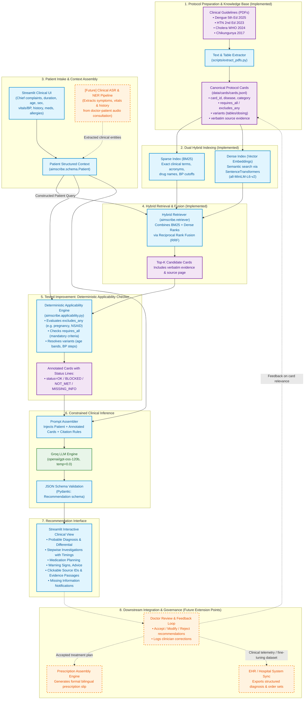

# Clinical Recommender System Architecture (Question 3)

## 1. System Overview & Architecture Diagram

This architecture represents the end-to-end design of the **AIMScribe Clinical Decision Support Engine** for General Practitioner (GP) clinics in Bangladesh, incorporating knowledge from the four national guidelines (Dengue 2025, Hypertension 2023, Cholera 2024, Chikungunya 2017).

The diagram distinguishes between components **Implemented in the Working Prototype** and **Future Component Extension Points**.

---

## 2. Component Breakdown

### Implemented Components (Current Working Prototype)
1. **Protocol Extraction (`scripts/extract_pdfs.py`):** Parses national guidelines into structured Markdown and tables.
2. **Canonical Card Knowledge Base (`data/cards/cards.jsonl`):** 158 structured cards with deterministic fields (`requires_all`, `excludes_any`, `variants`, `missing_info`) and linked verbatim evidence passages with page citations.
3. **Hybrid Search Index (`src/aimscribe/retriever.py`):** Dual-indexer combining BM25 keyword matching (for medical terminology, exact dosages, and lab tests) and Dense semantic embeddings (via `all-MiniLM-L6-v2`) fused using Reciprocal Rank Fusion (RRF).
4. **Interactive Clinical UI (`app.py`):** Streamlit interface allowing freeform case entry, 1-click loading of benchmark cases, baseline/improved mode toggle, and structured clinical output cards.
5. **Deterministic Applicability Checker (`src/aimscribe/applicability.py`):** **The tested improvement.** Executes locally in `<1 ms` without LLM calls. Evaluates structured criteria against patient fields and attaches machine-evaluated status tags (`OK`, `BLOCKED`, `NOT_MET`, `MISSING_INFO`) directly into the prompt.
6. **Strict Schema-Constrained Generation (`src/aimscribe/llm.py` & `prompts.py`):** Leverages `gpt-oss-120b` at temperature `0.0` with Pydantic JSON enforcement, strictly prohibiting ungrounded drug recommendations or hallucinations outside retrieved cards.

### Future Extension Points (Architectural Roadmap)
1. **Speech-to-Text & Clinical NER Intake:** An automated transcription pipeline (e.g. Whisper Bengali/English + BioClinicalBERT) that parses doctor-patient dialogue directly into the structured `Patient` schema.
2. **Clinician Feedback & Active Learning:** Doctor acceptance, editing, or rejection buttons for each card, logging clinician interaction telemetry to identify protocol gaps or ambiguous cards.
3. **Prescription Assembly Engine:** Formats verified medication regimens into standardized clinic prescription templates ready for printing or patient SMS.
4. **EHR / Hospital Information System (HIS) Integration:** REST/FHIR APIs syncing recommendations directly with hospital electronic health records.

---

## 3. Defense of Architectural Choices vs. Simpler Alternatives

### Choice 1: Hybrid Retrieval (BM25 + Dense RRF) vs. Pure Vector Search

 Pure vector search struggles severely with precise clinical tokens (e.g. "NS1", "SGOT/SGPT", "156/98 mmHg", "Plan B", "Amlodipine"). BM25 guarantees that exact acronyms, blood pressure numbers, and drug names receive high priority. Combining them with Reciprocal Rank Fusion (RRF) prevents retrieval failure across varied clinical phrasings.

### Choice 2: Deterministic Pre-LLM Checker vs. Pure Prompt-Based Reasoning

As proven in Reasoning Challenge and comparative evaluation, LLMs frequently experience "exclusion blindness" when contraindications are buried inside prose paragraphs. Moving hard constraints (such as age cutoffs, blood pressure thresholds, and pregnancy contraindications) into programmatic Python logic guarantees 100% mathematical consistency.

---

## 4. How a New Patient Detail Dynamically Changes Recommendations

The engine is completely dynamic. Modifying a single patient parameter cascades through the pipeline to alter the recommendations:

### Concrete Example: Patient C1 to Patient C6 (Dengue Severity Escalation)

* **Initial State (C1):** 24-year-old female, Day 3 fever, retro-orbital pain, drinking fluids well, no vomiting.
  * *Retriever:* Fetches dengue outpatient management cards (`DEN-ADV-008`, `DEN-RX-001`).
  * *Applicability Checker:* Warning signs criteria evaluate to `NOT_MET`. Home care criteria evaluate to `OK`.
  * *Recommendation:* **Home management**, oral hydration (2,400 mL/day), Paracetamol max 3 g/day, warning sign counseling, daily CBC monitoring.
* **New Patient Details Added (C6):** Clinician records `"persistent vomiting, severe abdominal pain, drinking poorly"`.
  * *Retriever:* Re-ranks warning sign cards (`DEN-ADV-001`, `DEN-ADV-011`) to top rank based on complaint tokens.
  * *Applicability Checker:* Warning sign rule (`persistent vomiting >=3 episodes`) triggers to Card `DEN-ADV-001` status becomes `TRIGGERED`. Outpatient home care card is marked `BLOCKED`.
  * *Recommendation Shift:* Home management is completely suppressed; the engine issues an urgent **Referral / Inpatient Admission Alert** for close monitoring of plasma leakage and impending dengue shock (*Dengue Guideline, p. 28, Table 7, p. 47*).

### Concrete Example 2: Pregnancy Flag in Hypertension
* A patient with Stage 1 Hypertension has `HTN-RX-001` (stepped care algorithm) retrieved.
* When `pregnant: true` is set, the applicability checker immediately marks the ARB escalation steps (`variants 3 & 4` — Losartan) as `BLOCKED`.
* The prompt explicitly notifies the LLM: `status=BLOCKED: pregnant -> ARB contraindicated (p. 64)`. The engine safely diverts to calcium channel blockers or methyldopa.
